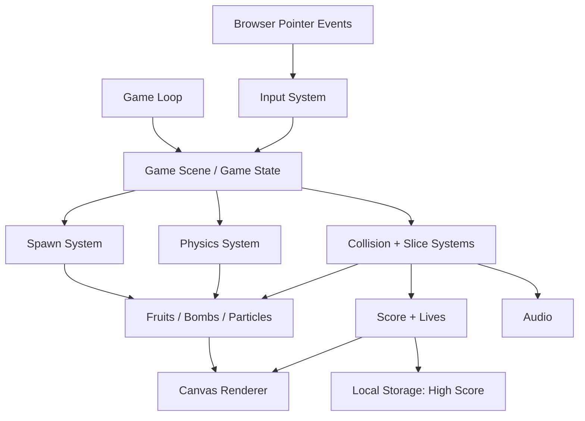

# Undampori Bash Game — Development Plan


> A browser-based, Fruit Ninja–style slicing game built with JavaScript, HTML5 Canvas, and Vite.
>
> **Goal:** Deliver a responsive, fun single-player game with mouse/touch slicing, airborne kerala style snacks, combos, bombs, sound effects, and persistent high scores — without requiring a backend.
>undampori means a snack from kerala
## 1. Scope

### MVP features
- [ ] Start, pause/resume, restart, and game-over screens.
- [ ] Responsive canvas playable on desktop and mobile.
- [ ] Snacks launch from below the screen in randomized waves.
- [ ] Gravity, velocity, and rotation drive fruit movement.
- [ ] Swipe trail tracks mouse, touch, and pen input through Pointer Events.
- [ ] Swipe-segment-versus-circle collision detects slices, including fast swipes.
- [ ] Sliced fruit is replaced by two animated halves and juice particles.
- [ ] Score increases on successful slices; combo bonus for multiple fruits sliced in a short window.
- [ ] Missing an unsliced fruit costs one life; the game ends after three misses.
- [ ] Slicing a undampori causes immediate game over (Classic mode rule).
- [ ] Audio feedback, mute toggle, and a locally stored high score.

### Out of scope for MVP
- Multiplayer, online leaderboards, accounts, and backend services.
- Real-time polygon slicing or complex fluid simulation.
- In-app purchases, achievements, and multiple game modes.

## 2. Technology and design decisions

| Layer | Choice | Rationale |
| --- | --- | --- |
| Language | Modern JavaScript (ES modules) | Lightweight and browser-native |
| Tooling | Vite | Fast local development and asset bundling |
| Rendering | HTML5 Canvas 2D | Efficient control of drawing and animation |
| Input | Pointer Events | Shared mouse, touch, and pen path |
| Animation | `requestAnimationFrame` | Synced to browser rendering |
| Physics | Custom 2D kinematics | Sufficient for fruit arcs and falling pieces |
| Sound | Web Audio API / preloaded audio | Low-latency effects |
| Persistence | `localStorage` | No backend needed for high scores/settings |
| Testing | Vitest plus browser/device checks | Unit-testable math and gameplay rules |

**Architecture:** A scene-based game with one owner of the mutable `gameState`. Systems update the state; renderers read it. Keep input, collisions, rules, and drawing separate.

## 3. Proposed file structure

```text
fruit-slice-game/
├── public/
│   └── assets/
│       ├── snacks/
│       ├── undampori/
│       ├── particles/
│       └── sounds/
├── src/
│   ├── core/
│   │   ├── Game.js
│   │   ├── GameLoop.js
│   │   ├── SceneManager.js
│   │   └── EventBus.js
│   ├── entities/
│   │   ├── Fruit.js
│   │   ├── undampori.js
│   │   ├── FruitPiece.js
│   │   └── Particle.js
│   ├── systems/
│   │   ├── InputSystem.js
│   │   ├── PhysicsSystem.js
│   │   ├── CollisionSystem.js
│   │   ├── SpawnSystem.js
│   │   ├── SliceSystem.js
│   │   ├── ParticleSystem.js
│   │   ├── ScoreSystem.js
│   │   └── AudioSystem.js
│   ├── rendering/
│   │   ├── Renderer.js
│   │   ├── FruitRenderer.js
│   │   └── TrailRenderer.js
│   ├── scenes/
│   │   ├── MenuScene.js
│   │   ├── GameScene.js
│   │   └── GameOverScene.js
│   ├── utils/
│   │   ├── math.js
│   │   ├── constants.js
│   │   └── storage.js
│   ├── main.js
│   └── style.css
├── tests/
│   ├── collision.test.js
│   └── scoring.test.js
├── index.html
└── package.json
```

**Implementation guideline:** Begin with a compact set of modules (`Game`, `InputSystem`, `PhysicsSystem`, `SliceSystem`, `Renderer`). Split further only when the gameplay loop works.

## 4. Runtime architecture



### Per-frame processing order
1. Calculate `deltaTime` (seconds), clamped to avoid huge jumps after tab inactivity.
2. Process queued pointer/swipe segments.
3. Spawn due fruits/bombs.
4. Update physics for fruits, bombs, pieces, and particles.
5. Detect swipe intersections and resolve hits once per entity.
6. Apply slice/bomb effects, scoring, and miss/game-over rules.
7. Prune inactive entities and expire old swipe points.
8. Render background, entities, effects, HUD, and swipe trail.

Use a **fixed timestep for gameplay physics** (for example, 1/60 second with an accumulator) to reduce frame-rate-dependent behavior; render on each animation frame. Limit catch-up steps and pause on `visibilitychange`.

## 5. Data contracts

```js
// snack / undampori(bomb) (same basic kinematic shape)
{
  id: 'snack-001',
  type: 'watermelon',        // or 'bomb'
  x: 250, y: 600,
  radius: 42,
  vx: 90, vy: -650,
  rotation: 0,
  angularVelocity: 2,
  active: true,
  sliced: false
}

// Game state (owned by GameScene)
{
  status: 'menu',           // menu | playing | paused | gameover
  score: 0,
  highScore: 0,
  lives: 3,
  combo: 0,
  elapsedTime: 0,
  difficulty: 1,
  fruits: [],
  bombs: [],
  pieces: [],
  particles: []
}

// Pointer input segment (canvas coordinates)
{
  start: { x: 100, y: 200 },
  end: { x: 180, y: 110 },
  time: 0
}
```

### Ownership rules
- `GameScene` manages transitions and authoritative state.
- `InputSystem` emits canvas-space swipe segments only while dragging.
- `PhysicsSystem` updates motion; `CollisionSystem` reports intersections.
- `SliceSystem` resolves snack/undampori hits and emits gameplay events.
- `ScoreSystem` applies scores, combo rules, and miss penalties.
- `Renderer` does not mutate gameplay state.

## 6. Feature implementation plan

### Phase 1 — Project foundation
- [0] Create a Vite vanilla-JavaScript project and set up npm scripts.
- [ ] Add a full-window canvas and handle resize + `devicePixelRatio`.
- [ ] Define logical game dimensions and translate pointer coordinates into canvas coordinates.
- [ ] Implement the game loop, scene state (`menu`, `playing`, `paused`, `gameover`), and a basic HUD.
- [ ] Add an asset loader with graceful fallback shapes for missing art.

**Checkpoint:** The menu can start a game; an empty scene updates and renders smoothly at different viewport sizes.

### Phase 2 — Fruit spawning and physics
- [ ] Implement fruit entities and an active entity collection.
- [ ] Launch fruits upward from random horizontal positions with randomized velocity.
- [ ] Apply gravity and rotation during fixed-step updates.
- [ ] Build wave-based spawning with increasing frequency/difficulty.
- [ ] Despawn objects after they move fully offscreen; distinguish fruits that were never sliced from already-sliced pieces.

**Checkpoint:** Repeated fruit waves rise, arc, fall, and clean up without memory growth.

### Phase 3 — Swipe input and slicing
- [ ] Use `pointerdown`, `pointermove`, `pointerup`, and `pointercancel`.
- [ ] Track a short pointer trail and draw a fading swipe effect.
- [ ] Implement **line segment vs. circle** collision; clamp the closest-point projection to `[0, 1]`.
- [ ] Test every new swipe segment against active fruits and bombs.
- [ ] Mark each hit entity immediately to prevent repeated slices.
- [ ] Create two sprite halves with outward impulse and falling motion.

**Checkpoint:** Fast desktop and mobile swipes reliably slice each fruit at most once.

### Phase 4 — Rules and progression
- [ ] Add base points per fruit (configurable constant).
- [ ] Count hits in a configurable combo window, awarding combo bonuses.
- [ ] Deduct a life for a fruit that falls away unsliced; cap at one deduction per fruit.
- [ ] Spawn bombs at a controlled rate and end the round if one is sliced.
- [ ] Show live score, lives, combo feedback, and a game-over summary.
- [ ] Reset all state correctly when restarting.

**Checkpoint:** A full round has clear win/lose feedback and no double-scoring or double-life-loss bugs.

### Phase 5 — Juice, audio, and polish
- [ ] Add particles and short-lived juice effects on successful slices.
- [ ] Add slice, combo, miss, and bomb sound effects with a mute toggle.
- [ ] Preload and cache fruit sprites and audio; avoid loading during gameplay.
- [ ] Add subtle screen shake for bomb hits and a lightweight combo animation.
- [ ] Add accessibility-friendly menu controls and readable HUD contrast.
- [ ] Save high score and mute preference to `localStorage` (with safe fallbacks).

**Checkpoint:** Gameplay feels responsive, effects do not obscure fruits, and preferences persist after reload.

### Phase 6 — QA and release
- [ ] Add unit tests for collision geometry and scoring rules.
- [ ] Test mouse, touchscreen, pen (if available), and multiple screen sizes.
- [ ] Test high-DPI rendering, resizing, tab switching, and restarts.
- [ ] Profile frame time, memory, garbage collection, and particle counts.
- [ ] Add particle pooling/caps if allocation spikes cause stutter.
- [ ] Build production assets and deploy the static site.

**Checkpoint:** The game is playable from a static host with no backend dependency.

## 7. Collision detection specification

For each active swipe segment `A → B` and fruit center `C`:

1. Compute the segment vector `D = B - A`.
2. Find projection `t = clamp(dot(C - A, D) / dot(D, D), 0, 1)`.
3. Compute closest point `P = A + t * D`.
4. A hit occurs when `distanceSquared(P, C) <= radiusSquared`.
5. Skip zero-length segments, inactive entities, and entities already marked sliced.

Keep collision logic in a pure, unit-tested math function. For a typical arcade-scale number of fruits, a linear scan is simpler than spatial indexing and fast enough.

## 8. Gameplay defaults (tunable)

| Setting | Initial value |
| --- | --- |
| Target physics step | 60 Hz |
| Lives | 3 |
| Base slice score | 1 point |
| Combo window | 250 ms |
| Initial simultaneous fruits | 1–3 |
| Bomb penalty | Immediate game over |
| Difficulty | Gradually shorten wave intervals and vary launch speed |
| Trail lifetime | 100–150 ms |

All values should live in `utils/constants.js` so game balancing does not require editing multiple modules.

## 9. Testing checklist

### Unit tests
- [ ] Segment intersects circle at center, edge, and endpoint.
- [ ] Segment misses a circle even if its infinite extended line would intersect.
- [ ] Zero-length segment does not produce invalid math.
- [ ] Each fruit scores and costs lives at most once.
- [ ] Combo window boundaries behave predictably.
- [ ] Bomb hit changes state to `gameover`.

### Manual tests
- [ ] Mouse swiping on desktop.
- [ ] Touch swiping on mobile without page scroll or text selection.
- [ ] Rapid consecutive swipes and swipe across multiple fruits.
- [ ] Resize/orientation changes without pointer alignment issues.
- [ ] Backgrounding/reopening the tab without giant physics jumps.
- [ ] Repeated start/restart cycles without stale input or entities.
- [ ] Sound disabled/enabled and high score persisted after refresh.

## 10. Performance goals

- Target smooth **60 FPS** on a typical modern desktop; degrade gracefully on mobile.
- Avoid DOM elements per snack; draw gameplay into Canvas.
- Cache assets; avoid per-frame asset creation.
- Keep particle counts bounded, and pool frequently spawned particles if necessary.
- Only process collisions for live entities and newly created swipe segments.
- Avoid large allocations inside the hot update/render loops.

## 11. Definition of done

The MVP is done when all of these are true:

1. A new user can start and restart a round without instructions.
2. Mouse and touch slicing both work, including fast gestures.
3. Fruits follow convincing arcs, are sliced once, and create visual/audio feedback.
4. Combos, lives, bombs, and game-over behave consistently.
5. High scores survive page reloads.
6. The game runs on desktop and mobile without major input or rendering bugs.
7. Unit tests for core collision and scoring pass, and a production build succeeds.

## 12. First coding session — recommended order

1. Clean the unnecessary code
2. Implement `GameLoop` and basic scene switching.
3. Draw a single circle-based fruit with initial velocity and gravity.
4. Add pointer-trail capture and rendering.
5. Add segment-circle collision and remove/mark the fruit on hit.
6. Add repeatable spawns, scoring, and game-over rules.
7. Replace placeholder circles with sprites and add effects.

**Guiding principle:** Make the core slice interaction feel good before investing heavily in artwork, menus, or extra modes.
